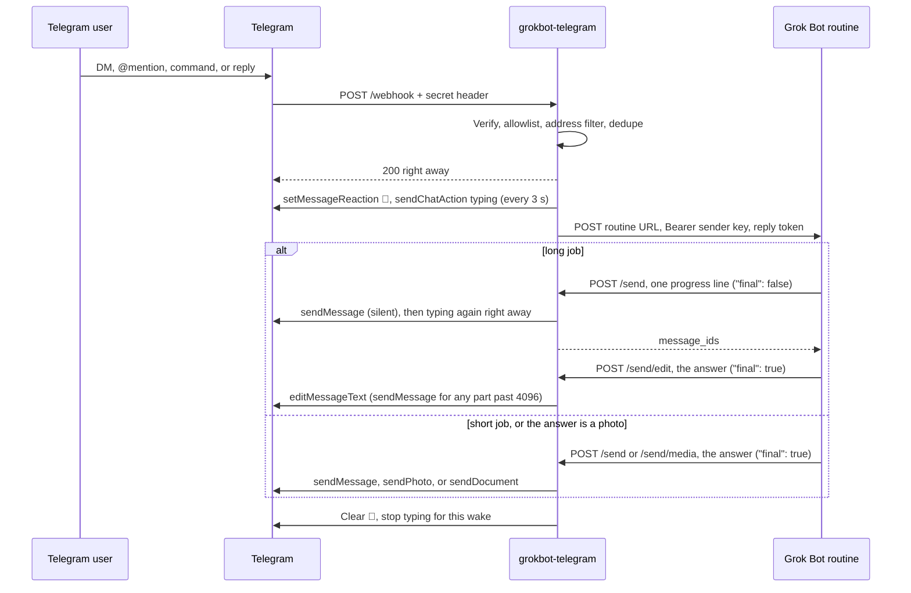

# grokbot-telegram

Connect a Grok Bot assistant to Telegram. People message the bot in a direct chat, or in a group by mentioning it, sending a command, or replying to it.

```text
Read https://github.com/jexmarc/grokbot-telegram and walk me through setting you up to connect with me on Telegram.
```

## Requirements

- Node.js 22 or newer, npm, and `openssl`.
- A Telegram account and a bot from [@BotFather](https://t.me/BotFather).
- One host. Cloudflare Workers, Vercel, or Node (Fly.io, Railway, Render, or a VPS).
- A checkout of this repo.

Other settings have defaults (see [Configuration](#configuration)). Setup is complete when `GET /healthz` returns `"ready": true` and an empty `problems` list.

### For agents

The fenced block above is the prompt a person pastes to start. Follow [Connect Grok Bot to Telegram](.grok/skills/telegram-connect/SKILL.md) one step at a time, and finish each check before the next step. On each later wake, follow [Reply in Telegram](.grok/skills/telegram-reply/SKILL.md).

## How it works

1. Telegram delivers an update to the bridge.
2. The bridge checks the webhook secret, the allowlist, and, in groups, whether the message addressed the bot.
3. The bridge answers Telegram at once, then wakes the Grok Bot webhook routine with a short-lived reply token.
4. The assistant replies through the bridge's `/send` endpoint. The bridge holds the bot token and sends the Telegram message.



## Setup

Copy [`.env.example`](.env.example) to `.env`. Put each value in that file once. Cloudflare, Vercel, Fly.io, Railway, Render, and a VPS load that same file for deploy. `npm run set-webhook` and `npm run set-commands` read it on every host. Delete a line you have not filled in before a host loads the file. An empty `KEY=` line is still a value.

```bash
cp .env.example .env
npm install
```

Create the bot with BotFather `/newbot`. Write the token on `TELEGRAM_BOT_TOKEN` and the username, with the `@` removed, on `TELEGRAM_BOT_USERNAME`. Run `openssl rand -hex 32` twice and write the results on `TELEGRAM_WEBHOOK_SECRET` and `REPLY_TOKEN_SECRET`. `TELEGRAM_WEBHOOK_SECRET` needs 16 to 256 characters from `A-Z`, `a-z`, `0-9`, `_`, and `-`. `REPLY_TOKEN_SECRET` needs at least 32 characters, and a different value for every bridge.

The bot stays silent until `npm run set-webhook` has succeeded. Message it anyway, so Telegram has an update to read. Then:

```bash
npm run webhook-info
npm run get-updates
```

`npm run get-updates` takes no offset. Read `message.from.id` and `message.chat.id` from the JSON. When `webhook-info` shows a `url`, `getUpdates` comes back empty even if `pending_update_count` is 1. Run `npm run delete-webhook`, then `npm run get-updates` again. You register the webhook again at the end of this section.

Write the ids into `.env`. `ALLOWLIST_USER_IDS` admits that person in direct messages and in every chat they speak in. `ALLOWLIST_CHAT_IDS` admits every sender inside that chat. With both empty, the bridge denies every sender. Leave `PUBLIC_BASE_URL`, `GROK_WEBHOOK_URL`, and `GROK_WEBHOOK_SENDER_KEY` out of the file until the steps below.

### Cloudflare Workers

Checked 8 October 2026. Workers Free includes 100,000 requests a day and SQLite Durable Objects at 100,000 requests a day, which covers a personal bot, and each invocation gets 10 milliseconds of CPU. The first paid plan is Workers Paid at $5 USD a month.

Wrangler is Cloudflare's command-line tool, installed by npm in this repo. You use it to log in, put secrets, and deploy this Worker.

```bash
npx wrangler login
npx wrangler deploy
```

Write the `workers.dev` origin Wrangler prints into `PUBLIC_BASE_URL` in `.env`. Remove any trailing slash. Then:

```bash
npx wrangler secret bulk .env
```

When `PUBLIC_BASE_URL` is already in `.env`, this one command deploys and uploads the file:

```bash
npx wrangler deploy --secrets-file .env
```

Leave `PATH_PREFIX` empty. Local dev reads `.env`. Wrangler reads `.dev.vars` when that file exists, so keep this setup's values in `.env` alone.

```bash
npm run cf:dev
```

### Vercel

Checked 8 October 2026. The Hobby plan is $0 a month for personal, non-commercial use and includes 1 million function invocations, 4 hours of active CPU, and 360 GB-hours of provisioned memory a month, which covers a personal bot. The first paid plan is Pro at $20 a month.

The Vercel CLI links this repo to a project and deploys it. It has no command that loads `.env`. Point the team Environment Variables page at that file (paste or import it). `npm run set-webhook` and `npm run set-commands` still read the local `.env`.

```bash
npx vercel link
npx vercel --prod
```

Write the deployment origin into `PUBLIC_BASE_URL` in `.env`. In the Vercel dashboard, open the team, then Settings, then Environment Variables. Paste or import `.env`, choose the environments, link the variables to this project, and save. Changes apply on the next deploy.

```bash
npx vercel --prod
```

`vercel.json` rewrites `/webhook`, `/send`, `/send/edit`, `/send/media`, `/file/*`, `/typing/stop`, `/typing/heartbeat`, and `/healthz` to `api/index.ts`. Leave `PATH_PREFIX` empty. The function `maxDuration` is 60 seconds so a proxied file can finish. A plan with a shorter cap uses that cap instead.

### Node

Checked 8 October 2026. Railway Free's $1 monthly credit does not cover a process left running, at $10 per GB-month of memory, and Hobby is $5 a month with $5 of credit included. Render's free web service is $0 for 512 MB and spins down after 15 minutes without a request, so the instance that stays up is $7 a month, and Fly.io has no free tier after a trial of 2 machine-hours or 7 days, with the smallest always-on machine at $2.19 per 30 days.

`npm start` runs this bridge with Node and reads `.env`. Each place below loads that same file, then you run `npm run set-webhook` and `npm run set-commands` from the checkout.

On a VPS, copy the checkout onto the machine so `.env` is next to the code, and start the process:

```bash
npm start
```

On Fly.io, `fly secrets import` is Fly's command for loading secrets. It reads `.env` from standard input. The start command on the app is `npm start`.

```bash
fly secrets import < .env
```

On Railway, open the service Variables RAW Editor and paste `.env`. The start command is `npm start`.

On Render, there is no bulk-secret command. Point the service environment at `.env`. The start command is `npm start`.

`npm start` listens on `PORT` (default 8080). Put HTTPS in front, and write that origin into `PUBLIC_BASE_URL` in `.env`. Load the file again with the same host step, then start.

### Routine, webhook, commands

Ask the bot to create a webhook routine with the saved prompt in step 9 of the [connect skill](.grok/skills/telegram-connect/SKILL.md). Replace `BRIDGE_ORIGIN` with the `PUBLIC_BASE_URL` origin. Open these two links, with the folder id of that routine, and write the values into `.env`.

```text
grokbot://app/v1/sidebar?target=webhook-url&automation=<routine folder id>
grokbot://app/v1/sidebar?target=webhook-key&automation=<routine folder id>
```

The first link copies the URL onto `GROK_WEBHOOK_URL`. The second copies the sender key onto `GROK_WEBHOOK_SENDER_KEY`. Load `.env` again the same way that host already did. Cloudflare is `npx wrangler secret bulk .env`. Vercel is another paste or import of `.env` on the team Environment Variables page, then `npx vercel --prod`. Fly.io is `fly secrets import < .env`. Railway is the RAW Editor again. Render is the service environment pointed at `.env` again. A VPS is a restart of `npm start` so it reads the file. Then:

```bash
npm run set-webhook
npm run set-commands
npm run webhook-info
```

Message the bot in a direct chat, then try a group.

## How the assistant replies

Each accepted update reaches the routine as JSON with `schema_version: 4` ([`schema/wake-event.v4.json`](schema/wake-event.v4.json)). Version 4 adds `callback` and `addressed_how: "callback"` for an inline button tap. `callback` is null on an ordinary message. Version 3 added `message.attachments`, `reply.send_media_url`, and `reply.edit_url`. Every earlier field is still there, and `POST /send` with text works as before. The `reply` object holds `send_url`, `send_media_url`, `edit_url`, and a signed token scoped to that chat and forum topic. A text send returns the Telegram `message_ids` it created. New tokens also carry the sender's user id, so a button can be bound to that person. Forward origin, links, quotes, external replies, structured contact, location, venue, and poll summaries are also included, with a `message.burst` array when a forward and a comment were merged.

```bash
curl -sS -X POST "$SEND_URL" \
  -H "Authorization: Bearer $REPLY_TOKEN" \
  -H "Content-Type: application/json" \
  -d '{"chat_id":"123","text":"Here is the answer.","reply_to_message_id":10,"final":true}'
```

`$SEND_URL` and `$REPLY_TOKEN` are `reply.send_url` and `reply.token`. Put `"final": true` on the answer. Once Telegram accepts it, the bridge stops typing, removes the 👀, and retires the token. Earlier sends are progress lines, and they go out silently. The response body includes `message_ids`.

A later `POST` to `reply.edit_url` (`/send/edit`) replaces the text of one of those messages. The same token authorizes it. The bridge keeps the ids it posted for this wake and rejects any other `message_id` with `403 {"ok": false, "error": "not_outbound"}`. `"final": true` on an edit is the answer: it uses the same one-final slot, and once Telegram accepts it the bridge stops typing, removes the 👀, and retires the token. A progress edit (`"final": false`) stays one bubble, renews the lease, and puts typing back. Telegram answers `message is not modified` when the text is already there; the bridge treats that as success, and a final edit still ends the wake.

```bash
curl -sS -X POST "$EDIT_URL" \
  -H "Authorization: Bearer $REPLY_TOKEN" \
  -H "Content-Type: application/json" \
  -d '{"chat_id":"123","message_id":55,"text":"Here is the answer.","final":true}'
```

`$EDIT_URL` is `reply.edit_url`. `message_id` is one id from the earlier `/send` response. An answer longer than 4096 characters is split: the first piece replaces that message and the rest are new messages, which notify. A progress edit over 4096 characters is `413 {"error": "edit_too_long"}`. A final edit that fails after the first piece is updated returns `502` with `"edited": true`. Sending that same edit once more skips bubbles already posted. An edit does not notify by itself. Telegram has no notification flag on `editMessageText`.

Edits of one message run one at a time, and the bridge checks again that the wake is still open after it gets that turn. A progress edit stuck in a Telegram rate-limit retry cannot replace an answer that already landed. The final slot stays closed, so that stale text is never written. If the other edit is still running after 30 seconds, `/send/edit` returns `409 {"ok": false, "error": "edit_in_progress"}` and leaves the bubble as it is.

A photo or a document uses `reply.send_media_url` (`POST /send/media`) with the same token. `"final": true` on a photo or document is the answer, and it uses the same one-final slot as text. A caption is optional and at most 1024 characters.

```bash
curl -sS -X POST "$SEND_MEDIA_URL" \
  -H "Authorization: Bearer $REPLY_TOKEN" \
  -H "Content-Type: application/json" \
  -d '{"chat_id":"123","kind":"photo","url":"https://cdn.example/plot.png","caption":"Last week","reply_to_message_id":10,"final":true}'
```

`kind` is `photo` or `document`. `url` must be `https`, with a hostname, and no username or password. The bridge does not download it. Telegram does. That keeps the request small on Vercel, whose platform body limit is about 4.5 MB. Telegram's own limits apply: photos about 10 MB, documents about 50 MB.

A small file can be uploaded instead, as `multipart/form-data`. The file field is `file`. The other fields are text, and `final` is the string `true` or `false`. The whole request must fit in `MAX_MEDIA_BYTES` (default 4,000,000, hard cap 4,194,304).

```bash
curl -sS -X POST "$SEND_MEDIA_URL" \
  -H "Authorization: Bearer $REPLY_TOKEN" \
  -F "chat_id=123" \
  -F "kind=document" \
  -F "caption=Notes" \
  -F "file_name=notes.txt" \
  -F "final=true" \
  -F "reply_to_message_id=10" \
  -F "file=@notes.txt"
```

The token lasts `REPLY_TOKEN_TTL_SECONDS` (30 minutes by default). It works for several sends until the final one, so the assistant can send a progress line and then the answer. It is valid only for its chat and topic. Use a different `REPLY_TOKEN_SECRET` for every bridge, because every bridge that shares a secret accepts the same tokens.

### Inline buttons

`/send` and `/send/media` take an optional `buttons` array of rows. Each button is `{ "text", "data" }` or `{ "text", "url" }`. `text` is the label, 1 to 64 characters. `data` is the action code, 1 to 27 bytes, with no control characters. `url` is `https`, with a hostname, and no username or password. A button has `data` or `url`, not both. At most 8 rows, 8 buttons in a row, and 32 buttons. A split text reply puts the keyboard on the last bubble. A multipart upload sends `buttons` as a text field containing that JSON array.

```bash
curl -sS -X POST "$SEND_URL" \
  -H "Authorization: Bearer $REPLY_TOKEN" \
  -H "Content-Type: application/json" \
  -d '{"chat_id":"123","text":"Deploy the preview?","reply_to_message_id":10,"final":true,"buttons":[[{"text":"Approve","data":"approve"},{"text":"Cancel","data":"cancel"}]]}'
```

The bridge signs each `data` with `REPLY_TOKEN_SECRET`. The token is bound to the chat and, for a reply-token send, to the person that wake came from. It fits in Telegram's 64-byte `callback_data`, so a tap verifies on any instance. Buttons stay tappable for `REPLY_TOKEN_TTL_SECONDS` after the send. A URL button does not wake the bot.

A tap is a new wake. `addressed_how` is `"callback"`. `callback.data` is the action, `callback.text` is the label, `callback.message_id` is the bot message, and `callback.message_text` is that message's full text or caption, up to Telegram's 4096-character limit. `from` is who tapped. `reply.token` is new. The bridge calls `answerCallbackQuery` immediately. The callback data has to be one of the buttons on that message; a token from a different keyboard in the same chat is ignored and does not use up that message's tap. The first accepted tap removes the keyboard. A second tap on that message answers "Already chosen." and does not wake again. A tap from anyone else answers "That button isn't for you." and does not wake. The allowlist still applies. An operator send made with `OUTBOUND_API_KEY` has no wake user, so its callback buttons are bound to the chat only: any allowlisted sender in that chat can tap.

On Vercel and Node the one-tap claim lives in that process's memory, same as other dedupe. The signature check does not. A second instance can still accept a second tap until it sees the keyboard is gone. Cloudflare stores the claim in the chat's Durable Object.

`/send`, `/send/edit`, and `/send/media` share one final slot per wake:

- **One final per wake.** A repeated `"final": true` after delivery returns `200 {"ok": true, "already_sent": true, "message_ids": [...]}`. A final photo, a final text, and a final edit are the same slot. The record lasts as long as the token. When two finals race, one sends and the other gets `409 {"ok": false, "ambiguous": true, "error": "send_in_progress"}`.
- **`idempotency_key` on progress lines.** Use 1 to 128 characters from `A-Z a-z 0-9 . _ : -`. A repeat of a delivered key returns `already_sent`. Operator sends with `OUTBOUND_API_KEY` accept a key too.
- **An ambiguous send counts as sent.** The bridge retries a Telegram send only on HTTP 429. After a timeout, a reset, a 5xx, or an unreadable 200, it returns `502 {"ok": false, "ambiguous": true, "error": "telegram_send_ambiguous"}`. A repeat of that final or key returns `409 {"ambiguous": true, "error": "previous_send_ambiguous"}`. A definite failure (`"ambiguous": false`) frees the final or key, so the missing part can go out once.

## Incoming files

A photo, document, video, animation, audio, voice message, video note, or sticker arrives as `message.attachments`. The caption is `message.text`. `message.media` is still the list of kind names, including kinds that are not files (`contact`, `location`, `poll`).

Each attachment has `kind`, `mime_type`, `file_name`, `file_size`, `width`, `height`, `duration`, `file_url`, and `unavailable`. For a photo, the bridge picks the largest size. The file id stays inside a signed token. The bot token is not in the payload.

```bash
curl -sS "$FILE_URL" -H "Authorization: Bearer $REPLY_TOKEN" -o photo.jpg
```

`$FILE_URL` is that attachment's `file_url`. The bridge calls Telegram `getFile` and streams the bytes. `GET` needs the reply token from the same wake. A token from another chat, topic, or wake gets 403 `scope`. `OUTBOUND_API_KEY` cannot fetch files. Fetching does not send a message and does not end the wake. The URL works until the token expires.

Telegram's `getFile` limit is 20 MiB (20971520 bytes). Over that, `file_url` is null and `unavailable` is `"too_large"`. A download Telegram still rejects returns `413 {"ok": false, "error": "file_too_large", "limit": 20971520}`.

The response sets `X-Content-Type-Options: nosniff`. Types the bridge will not label, including `text/html`, are served as `application/octet-stream`. The declared type is still on the attachment as `mime_type`.

File authorization is the signed URL plus the reply token, not a row in the store, so a fetch works on Vercel even when it hits a different instance than the webhook.

## Forwards, replies, quotes, and other messages

All of this is untrusted, same as `message.text`. Sizes are capped. The bridge does not fetch URLs.

- **Forward.** `message.forward` is set when the waking message itself was forwarded. `type` is `user`, `hidden_user`, `chat`, or `channel`. `sender_name`, `username`, `chat_title`, and `date` (unix time of the original) describe the origin. `message.text` and `message.attachments` are the forwarded text or caption and its files. Legacy `forward_from` / `forward_sender_name` / `forward_from_chat` updates are read the same way.
- **Reply.** `message.reply_to` is the parent in this chat, including when that parent is not the bot. It carries text or caption, `from`, `attachments`, `links`, and a contact, location, venue, or poll when the parent had one. Files on the parent are fetched with this wake's reply token.
- **Quote.** `message.quote` is the highlighted fragment: `text`, `position`, `is_manual`.
- **Other chat.** `message.external_reply` is a reply to another chat. Telegram does not include that message's text. The object has `origin` (same shape as `message.forward`), `chat_title`, `chat_username`, `message_id`, and any media or attachments.
- **Links.** `message.links` lists `url` and `text_link` entities: `{kind, url, text}`. `text` is the visible label for a `text_link` and null for a plain url. At most 10, http and https only, no credentials.
- **Contact, location, venue, poll.** Each is a compact object or null. A venue message also keeps its point in `location`. `message.media` still lists the kind names. A poll has `question`, `type`, up to 10 `options` of `{text, voter_count}`, and the counts.

Telegram sends a forward and the person's comment ("handle this") as two updates, the forward first, and it waits for the webhook response before the next update. The bridge answers 200 immediately and holds the forward in the chat's store for `FORWARD_BURST_MS` (default 1500, maximum 5000). A following message from the same sender, in the same chat and forum topic, joins that burst and resets the wait. One wake goes out: `message` is the comment when there is one, so the reply threads under it, and `message.burst` is the earlier messages in order (text, sender, forward origin, attachments, links, and the same summaries). A forward with no comment is a normal wake with `message.forward` set and `burst` empty. A group forward that nobody follows does not wake the bot. `0` turns the wait off, and each update wakes on its own.

The wait uses the same store as dedupe. On Cloudflare the chat Durable Object is shared, so the two updates merge. On Node one process shares the store, so they merge. On Vercel the store is the memory of one instance. They merge when both updates hit that instance, which is common on a warm function and not guaranteed. When they miss, the bot gets two wakes: the forward, then the comment. `short_term` on the later wake includes the earlier text only if both updates hit the same store. If the instance stops during the wait, Telegram will not retry that update. A later message in the same chat within 60 seconds flushes a burst that was left behind; after that the burst is dropped. Set `FORWARD_BURST_MS=0` to skip the wait.

## Hosts

| Host | Typing indicator | Dedupe and state |
| --- | --- | --- |
| **Cloudflare Workers** (recommended) | A Durable Object alarm refreshes typing every 3 seconds while any wake in the chat holds its lease. Wakes survive eviction and restarts. | Durable Object storage. The `dedupe` object claims each `update_id` and holds `/send` records. Each chat's object claims each message and holds context, rate limits, and typing. |
| **Vercel** | One typing action when the wake starts and one after each progress line. Telegram shows each for about 5 seconds. The 👀 stays until the answer. | The memory of that instance. |
| **Node** | An in-process timer refreshes typing every 3 seconds until the final send, `/typing/stop`, a failed forward, or the end of the lease. | The memory of that process. |

On Vercel and Node, dedupe state lasts as long as the process. A Telegram retry that reaches a restarted process or a second instance can wake the bot again. Choose Cloudflare if that matters to you.

Cloudflare, Vercel, Fly.io, Railway, Render, and a VPS load the gitignored `.env`. The commands are in [Setup](#setup). `npm run set-webhook` and `npm run set-commands` read that file on every host. Local `wrangler dev` reads it too. Wrangler reads `.dev.vars` when that file exists, so keep the setup values in `.env` alone.

Vercel serves `/webhook`, `/send`, `/send/edit`, `/send/media`, `/file/*`, `/typing/stop`, `/typing/heartbeat`, and `/healthz` from one function, `api/index.ts`, so every route shares that instance's memory. The 👀 clears when the final answer reaches the instance that took the message. The ids `/send/edit` is allowed to change live in that same memory, so the edit has to reach the instance that sent the message. The team Environment Variables page is where Vercel loads `.env`. The next `npx vercel --prod` deploys those values. A file the bot fetches is streamed from Telegram through that function. `vercel.json` sets `maxDuration` to 60 seconds. Photos of a few megabytes finish well inside a shorter plan cap. A file near the 20 MB getFile limit needs the longer cap.

On Node, `npm start` reads `.env` and listens on `PORT` (default `8080`). Fly.io loads the file with `fly secrets import < .env`. Railway loads it through the Variables RAW Editor. Render loads it by pointing the service environment at `.env`. A VPS loads it by keeping `.env` next to the code.

## Progress feedback

After a message wakes the bot, the person sees:

1. A 👀 reaction on their message and "typing…" in the chat, right away.
2. On a job of about 45 seconds or more, one short progress line from the assistant, sent silently. The assistant then edits that line into the answer, so the person sees one bubble update.
3. The answer, with a normal notification when it is a new message. The 👀 and typing end when Telegram accepts a `"final": true` send or a `"final": true` edit. An edit of the progress bubble does not itself notify.

The details:

- **Typing per wake.** Each chat and forum topic keeps a set of active wakes. The bridge sends one `sendChatAction` per chat every `TYPING_REFRESH_MS` while any wake is active. A new message adds its own wake.
- **Ends on delivery.** A `"final": true` send or edit ends its wake after Telegram accepts the whole message. If that call fails, typing, the 👀, and the token stay, so the assistant can finish. `/typing/stop` ends one wake. A final edit clears the reaction the same way a final send does. Other wakes in the chat keep theirs, and typing stays up for them.
- **Typing returns after a progress line or a progress edit.** Telegram clears typing when the bot posts, so the bridge sends typing again right after each non-final send or edit.
- **One bubble, then edit.** `POST /send` with `"final": false` returns `message_ids`. `POST /send/edit` with that id replaces the text. Only ids this wake's `/send` recorded can be edited, and the bridge checks that itself. A final edit longer than 4096 characters puts the first piece in the existing bubble and sends the rest. Photos and documents are not editable this way; send those as their own final message.
- **Draft placeholder stays off.** `TELEGRAM_DRAFT_PLACEHOLDER` (`sendMessageDraft`, default `false`) is a private-chat preview that says "Thinking…" for about 30 seconds. It is not this feature. A draft has no `message_id`, it disappears on its own, and Telegram only supports it in private chats, so the answer cannot replace it and a group cannot see it. Leave the flag off. Progress-then-edit is the path that updates one real message in any chat the bot is in.
- **Lease.** Each wake starts with a `TYPING_LEASE_MS` lease (10 minutes). Each progress line, each progress edit, and each `POST /typing/heartbeat` renews it, up to `TYPING_MAX_MS` (30 minutes) from the start and up to the token's expiry. When the lease ends, the bridge stops typing, clears the 👀, and logs `typing_lease_expired`.
- **Reaction.** The bridge sets `PROGRESS_REACTION` (default 👀). If a chat limits reactions, the bridge logs `reaction_failed` and keeps typing.
- **Incoming edits.** One Telegram message starts at most one wake. The bridge ignores edits of a message that already woke the bot and logs `edit_ignored`. An edit that first addresses the bot, such as one that adds `@YourBot`, wakes it once with `edited: true`. The bridge remembers woken messages for 7 days.
- **Failed forward.** The bridge sends each wake to Grok Bot in a single POST.
  - After a definite failure, the bridge stops typing, clears the 👀, and posts `FORWARD_FAILURE_TEXT` once, silently. A definite failure is a non-2xx other than a gateway error, a redirect, a refused connection, a DNS failure, or a TLS failure before the request went out.
  - After an ambiguous failure, the bridge logs `forward_ambiguous` and keeps the wake open until the final send, `/typing/stop`, or the end of the lease. An ambiguous failure is a timeout, a reset, a later network error, or HTTP 502, 504, 520, or 524. A late answer still goes out once.

## Group chats

In a private chat, every message from an allowlisted sender or chat wakes the bot. In a group or supergroup, the bot wakes when a message:

- mentions `@YourBot`,
- starts with a command from `WAKE_COMMANDS`, such as `/ask` or `/ask@YourBot`, or
- replies to one of the bot's own messages.

The bridge keeps other group messages in a per-topic buffer (`CONTEXT_LIMIT`, 10 by default) and attaches them to the next wake as context. It ignores messages from other bots. In Telegram's default privacy mode the bot receives `/ask@YourBot`, replies to its own messages, and service messages. Turn privacy off with BotFather `/setprivacy`, or make the bot an admin, then remove the bot from the group and add it again.

When the bot is in the groups you want, send BotFather `/setjoingroups` and choose Disable to keep it to those groups.

Forum topics keep their own context and typing state. In a supergroup with topics off, replies go to the main chat.

When a basic group becomes a supergroup, the chat id changes. The bridge logs `chat_migrated`. Update `ALLOWLIST_CHAT_IDS` with the new id.

## Allowlist

- A **user id** admits that person in direct messages and in any chat they speak in. A teammate's user id also opens a private chat with the bot, so use the group's chat id to admit only the group.
- A **chat id** admits every sender inside that chat.

Ids are plain decimal numbers (`42`, `-500`). `/healthz` lists any other value under `problems`.

Messages sent as a chat (anonymous group admins, or posts as a channel) carry `sender_chat`. Only the chat's id in `ALLOWLIST_CHAT_IDS` admits them, and their wake has `from: null`. The bridge ignores automatic forwards from a linked channel.

`OUTBOUND_API_KEY` (at least 32 characters) sends to allowlisted chats outside a wake. Set it only for proactive messages, and keep it with the operator.

## Configuration

| Variable | Required | Purpose |
| --- | --- | --- |
| `TELEGRAM_BOT_TOKEN` | yes | BotFather token. Stays on the bridge. |
| `TELEGRAM_WEBHOOK_SECRET` | yes | Checked against `X-Telegram-Bot-Api-Secret-Token`. 16-256 characters of `A-Z a-z 0-9 _ -`. |
| `TELEGRAM_BOT_USERNAME` | yes | Bot username, `@` removed. Groups match @mentions, `/command@bot`, and replies with it. |
| `TELEGRAM_BOT_ID` | no | Numeric id from `getMe`. Sharpens reply detection. |
| `GROK_WEBHOOK_URL` | yes | Routine webhook URL. HTTPS, or `http` with `ALLOW_INSECURE_WEBHOOK=true`. |
| `GROK_WEBHOOK_SENDER_KEY` | yes | Sent as `Authorization: Bearer`. A missing key gets a 401 from Grok Bot. |
| `REPLY_TOKEN_SECRET` | yes | HMAC key for reply tokens. At least 32 characters, unique per bridge. |
| `PUBLIC_BASE_URL` | yes | `https` origin for `reply.send_url` (`http` for localhost). Origin only. |
| `ALLOWLIST_USER_IDS` | one of these | Comma-separated numeric user ids. |
| `ALLOWLIST_CHAT_IDS` | one of these | Comma-separated chat ids. |
| `PATH_PREFIX` | no | Mount prefix, for example `/bridge`. |
| `WAKE_COMMANDS` | no | Default `/ask,/help`. |
| `OUTBOUND_API_KEY` | no | Key for proactive sends. At least 32 characters. |
| `BRIDGE_ACK` | no | Default `false`. When `true`, the bridge sends "On it." before the assistant speaks. |
| `FAST_GREETING` | no | Default `false`. When `true`, the bridge itself answers a bare "hi", "ping", or "thanks". |
| `REPLY_TOKEN_TTL_SECONDS` | no | Default `1800` (30 min). Clamped to 60-3600. Also caps how long typing and the 👀 last. |
| `TYPING_REFRESH_MS` | no | Default `3000`. Clamped to 1000-4500. One typing action per chat per refresh. |
| `TYPING_LEASE_MS` | no | Default `600000` (10 min). Clamped to 60000-3600000 and to `TYPING_MAX_MS`. Renewed by each progress line and heartbeat. |
| `TYPING_MAX_MS` | no | Default `1800000` (30 min). Clamped to 60000-7200000. Ceiling per wake from its start. |
| `PROGRESS_REACTION` | no | Default `👀`. An emoji from the Bot API's `ReactionTypeEmoji` list, or `off`. `/healthz` lists any other value under `problems`, and the bridge uses the default. |
| `FORWARD_FAILURE_TEXT` | no | Default "Sorry — I couldn't pick that up just now. Mind sending it again?". Up to 500 characters, or `off`. |
| `TELEGRAM_DRAFT_PLACEHOLDER` | no | Default `false`. Private-chat `sendMessageDraft` preview. Not the progress-then-edit path; leave it off. |
| `CONTEXT_LIMIT` | no | Default `10` prior messages per chat and forum topic, up to 7 days old. |
| `RATE_LIMIT_MAX` / `RATE_LIMIT_WINDOW_MS` | no | Default 20 wakes per minute per chat and per user in that chat. |
| `DEDUPE_TTL_MS` | no | Default `86400000` (24 h). How long `update_id` claims and operator `idempotency_key` records last. |
| `FORWARD_BURST_MS` | no | Default `1500`. Clamped to 0-5000. Wait after a forward so the sender's following comment joins one wake. `0` wakes on each update immediately. |
| `MAX_BODY_BYTES` | no | Default `1000000`, minimum 1024. Enforced while streaming, on every host. |
| `MAX_MEDIA_BYTES` | no | Default `4000000`, minimum 1024, hard cap `4194304` (4 MiB). The multipart upload limit for `POST /send/media`, kept under Vercel's ~4.5 MB request body limit. Larger files use an https `url`. |
| `ALLOW_INSECURE_WEBHOOK` | no | Default `false`. Allows an `http://` Grok webhook for local development. |

## Endpoints

| Method | Path | Caller |
| --- | --- | --- |
| `POST` | `/webhook` | Telegram |
| `POST` | `/send` | The assistant, with the reply token. Text. Returns `message_ids`. |
| `POST` | `/send/edit` | The assistant, with the reply token. Replaces the text of a message this wake sent. |
| `POST` | `/send/media` | The assistant, with the reply token. One photo or document, by https URL or a small upload. |
| `GET` | `/file/<token>` | The assistant, with the reply token. Streams one file from the wake that signed `<token>`. |
| `POST` | `/typing/stop` | The assistant, with the reply token. Ends that wake. |
| `POST` | `/typing/heartbeat` | The assistant, with the reply token. Renews the wake's lease. |
| `GET` | `/healthz` | You, or your platform's health check |

## Scripts

```bash
npm install
npm test
npm run typecheck
npm run lint
npm run set-webhook
npm run set-commands
npm run webhook-info
npm run get-updates
npm run delete-webhook
npm run cf:dev
npm run cf:deploy
```

`set-webhook`, `set-commands`, `webhook-info`, `get-updates`, and `delete-webhook` read `.env`. `get-updates` calls `getUpdates` with no offset. `set-webhook` subscribes Telegram to `message`, `edited_message`, and `callback_query`, and refuses an invalid webhook secret or a non-https `PUBLIC_BASE_URL`. The scripts print Telegram's `ok`, `description`, and `result` fields. Run `set-webhook` again after upgrading so Telegram starts delivering button taps.

## Security

- The bridge compares `X-Telegram-Bot-Api-Secret-Token` with `TELEGRAM_WEBHOOK_SECRET` in constant time. If the secret is unset or invalid, `/webhook` returns 503.
- The Node server starts only with a valid webhook secret, `REPLY_TOKEN_SECRET`, and `PUBLIC_BASE_URL`. On Workers and Vercel, `/healthz` reports `ready: false` instead, and the bridge logs each dropped wake at `level: "error"`.
- An empty allowlist denies everyone.
- Reply tokens are HMAC-SHA256 over the chat, topic, wake id, expiry, and, on new wakes, the sender's user id, checked in constant time. A final send retires the token. A file URL is a separate HMAC (`f1~…`) over the same chat, topic, wake, and the Telegram file id. `GET /file` requires both, and the reply token's wake must be the one that signed the file. The long-lived `OUTBOUND_API_KEY` cannot fetch files.
- Inline button `callback_data` is a separate HMAC (`cb1`) over the chat, the owner (or the chat only, for an operator send), the expiry, and the action. A tap from another chat or person fails that check. The token must also be a button on the message Telegram delivered with the tap, so a token from another keyboard in the same chat cannot claim it. The first accepted tap claims the bot message and clears the keyboard. URL buttons are https only.
- The bridge builds `reply.send_url`, `reply.send_media_url`, `reply.edit_url`, and attachment `file_url`s from `PUBLIC_BASE_URL` only. A file response is proxied. The bridge never redirects to `api.telegram.org`, because that URL contains the bot token.
- Telegram `getFile` stops at 20 MiB (20971520 bytes). A larger file is described with `file_url: null` and `unavailable: "too_large"`. If Telegram still rejects the download, `GET /file` returns 413 `file_too_large`.
- `POST /send/media` passes an https URL to Telegram, which downloads it. The bridge does not fetch that URL. It rejects non-https URLs, URLs with credentials, IP literals, localhost, and `api.telegram.org`. An upload is capped by `MAX_MEDIA_BYTES`.
- The Grok webhook URL comes from configuration. A redirect counts as a failed forward.
- Text from Telegram users (text, names, titles, `reply_to`, `forward`, `links`, `quote`, `external_reply`, `burst`, contact, location, venue, poll, `short_term`, attachment file names) is untrusted, and so are the bytes behind `file_url`. The bridge does not fetch `links`. It strips control, bidi, zero-width-space, and Unicode tag characters, caps sizes, escapes `<`, `>`, and `&` in the forwarded JSON, and adds `untrusted_content_notice`. The routine prompt tells the assistant to treat that content as data and to send only to the pinned bridge origin.
- Telegram calls go only to `api.telegram.org`, and only with a well-formed bot token.
- `/send`, `/send/edit`, and `/send/media` check the bearer before they read the body. `GET /file` checks it before calling Telegram. `/send/edit` allows only message ids this wake's `/send` recorded in the store. The caller cannot widen that set.
- The bridge splits outgoing text at 4096 UTF-16 units, on a paragraph, then a line, then a hard cut that keeps surrogate pairs whole. It sends plain text. A final edit puts the first piece into the existing message and sends the rest. On HTTP 429 it waits `retry_after` when that is 5 seconds or less, at most twice, and returns longer waits to the caller as `retry_after`. Telegram's `message is not modified` on an edit is success.
- Logs are single-line JSON. They carry drop reasons (`not_allowlisted`, `not_addressed`, `duplicate`, `rate_limited`) with chat and user ids, which you need for the allowlist. The logger redacts secrets and bearer values.
- Keep secrets in the gitignored `.env`. Cloudflare, Vercel, Fly.io, Railway, Render, and a VPS load that file. `.env.example` holds placeholders.

## License

[MIT](LICENSE). Copyright grokbot-telegram contributors.
